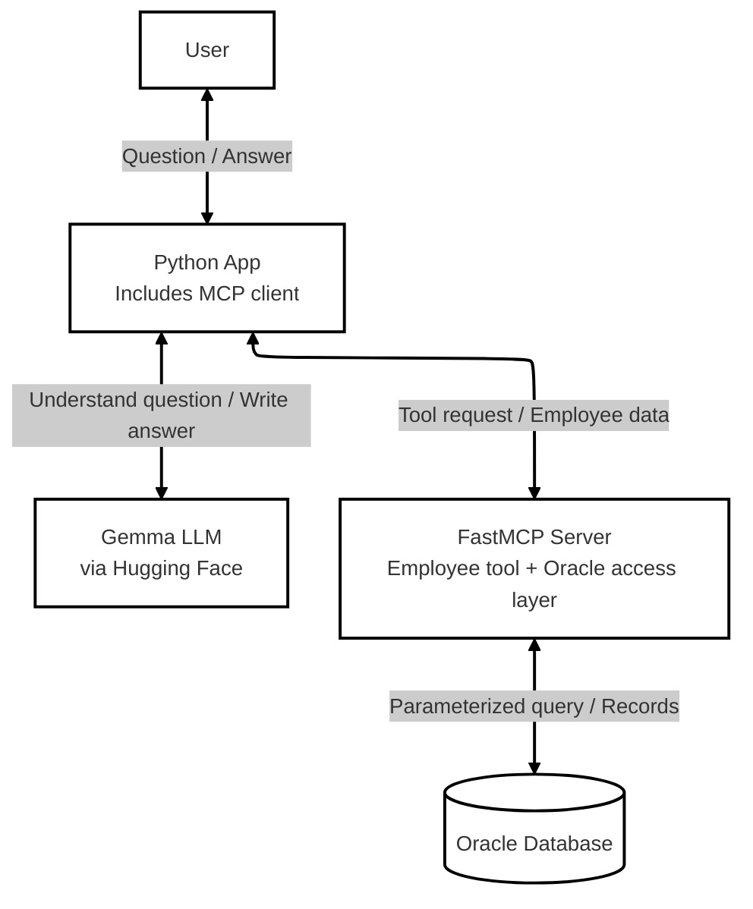
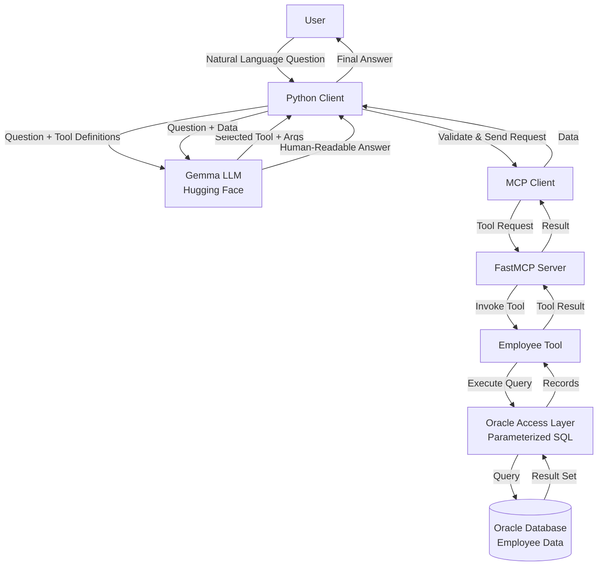
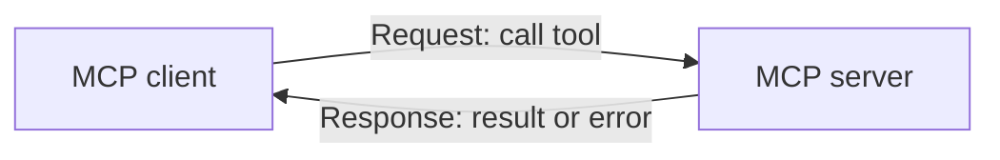

# Oracle HR MCP Server


## What is MCP?

**MCP stands for Model Context Protocol.**

MCP is a standard way for an AI application to communicate with external tools and data sources.

Examples of things an AI application can connect to through tools include:
- Databases
- Files
- APIs
- Business applications

MCP is **not** an LLM, database, or AI model. It is a communication protocol.


A Python-based Model Context Protocol (MCP) server that exposes selected Oracle HR database operations as tools. Users can ask employee-related questions in natural language; an LLM selects an approved tool, the MCP client invokes it, and the retrieved records are turned into a readable answer.

[MCP message-pattern specification](https://modelcontextprotocol.io/specification/2026-07-28/basic/patterns/index).

> **Implementation note:** This project description covers the Oracle HR design described in the source material. Remote HTTP hosting, OAuth authentication, resources, prompts, subscriptions, and other protocol features should be treated as future work unless they are implemented in the code.
## What are we building?

The user asks a question such as:

> Find the employee details for employee ID 100.

The AI application uses an LLM to understand the question, calls a tool to retrieve data from Oracle Database, and returns a human-readable answer.

**Flow:**

User → Python Client → Gemma LLM → Select Tool → MCP Client → MCP Server → Employee Tool → Oracle Database → Return Data → LLM → User

## Architecture



### Core design principle

- **LLM:** interprets the question and formats the final response.
- **Python client:** coordinates the workflow and validates the model's routing output.
- **MCP:** provides a standard client-server interface for calling approved tools.
- **Oracle access layer:** runs parameterized SQL and returns structured records.

The LLM does **not** directly connect to Oracle or execute SQL.

## Repository layout

```text
oracle_database_hr_server/
├── local_server.py       # FastMCP server and tool definitions
├── hr_db_tools.py        # Oracle connection and SQL functions
├── hr_llm_invoke.py      # LLM initialization and invocation helpers
├── hr_client.py          # Main client workflow
├── prompts.txt           # Tool-selection instructions
├── requirements.txt      # Python dependencies
├── .env.example          # Suggested environment-variable template (if added)
├── .gitignore            # Ignore secrets and local environment files
└── README.md
```

The `.env.example` and `.gitignore` entries are recommended repository additions; create them if they are not already present.

## Technology stack

| Technology | Responsibility |
|---|---|
| Python | Application logic |
| Oracle Database | Employee and department data |
| `python-oracledb` | Database connectivity |
| FastMCP | MCP server and tool registration |
| LangChain | LLM integration |
| Hugging Face | Hosts the configured Gemma model endpoint |
| `asyncio` | Asynchronous client workflow |

Model repository described in the source design: `google/gemma-3-27b-it`.

## Tools exposed by the server

| Tool | Input | Purpose |
|---|---|---|
| `get_employee_by_id` | `employee_id` | Retrieve an employee by ID |
| `search_employee_by_name` | `name` | Search first and last names |
| `get_employees_by_department_id` | `department_id` | Retrieve employees by department ID |
| `get_employees_by_department_name` | `department_name` | Retrieve employees by department name |

Tool names and input schemas in this table should match the decorators and function signatures in `local_server.py`.

## Request lifecycle



## MCP protocol pattern used

The MCP specification describes interactions using JSON-RPC requests, responses, and notifications. In the basic workflow documented here, the client initiates a tool call and the server returns a result or error.



Protocol considerations:

- The client initiates requests.
- The server responds to requests with a result or error.
- A failed request should be handled as an error rather than silently treated as successful.
- The MCP server should not independently initiate JSON-RPC requests.
- Progress notifications, multi-round-trip input, and subscription-based notifications are additional patterns; this project should not claim to implement them unless the code explicitly supports them.

See the [MCP Message Patterns specification](https://modelcontextprotocol.io/specification/2026-07-28/basic/patterns/index) for the normative protocol details.

