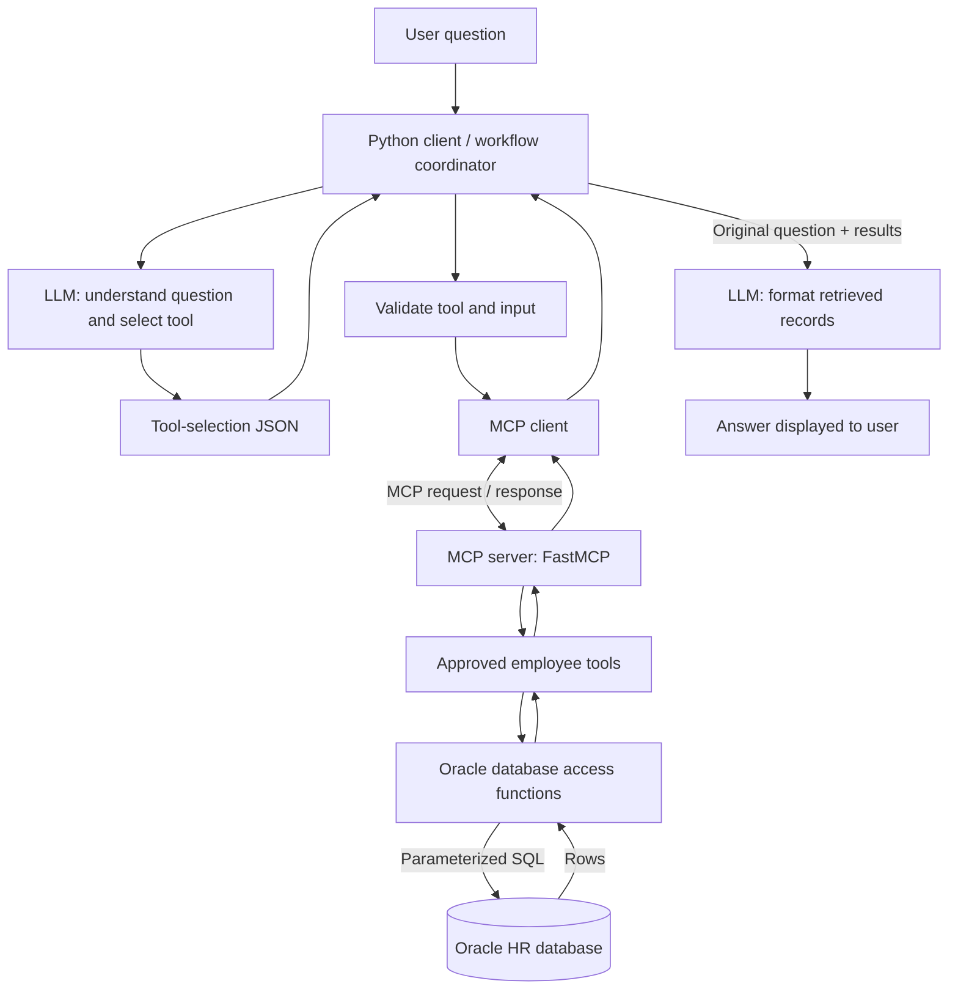
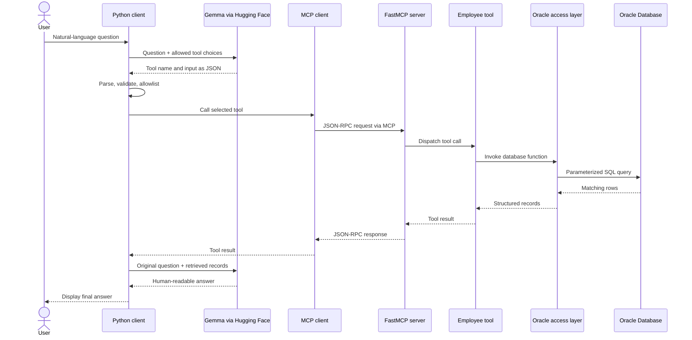
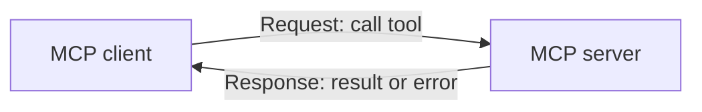

# Oracle HR MCP Server

A Python-based Model Context Protocol (MCP) server that exposes selected Oracle HR database operations as tools. Users can ask employee-related questions in natural language; an LLM selects an approved tool, the MCP client invokes it, and the retrieved records are turned into a readable answer.

[MCP message-pattern specification](https://modelcontextprotocol.io/specification/2026-07-28/basic/patterns/index).

> **Implementation note:** This project description covers the Oracle HR design described in the source material. Remote HTTP hosting, OAuth authentication, resources, prompts, subscriptions, and other protocol features should be treated as future work unless they are implemented in the code.

## What it does

Ask questions such as:

- “Who is employee 100?”
- “Find employees named Steven.”
- “Who belongs to department 70?”
- “Show employees working in the IT department.”

The application uses a fixed set of employee tools instead of letting the LLM generate and execute arbitrary SQL.

## Architecture



### Core design principle

- **LLM:** interprets the question and formats the final response.
- **Python client:** coordinates the workflow and validates the model's routing output.
- **MCP:** provides a standard client-server interface for calling approved tools.
- **Oracle access layer:** runs parameterized SQL and returns structured records.

The LLM does **not** directly connect to Oracle or execute SQL.

## Repository layout

```text
oracle_database_hr_server/
├── local_server.py       # FastMCP server and tool definitions
├── hr_db_tools.py        # Oracle connection and SQL functions
├── hr_llm_invoke.py      # LLM initialization and invocation helpers
├── hr_client.py          # Main client workflow
├── prompts.txt           # Tool-selection instructions
├── requirements.txt      # Python dependencies
├── .env.example          # Suggested environment-variable template (if added)
├── .gitignore            # Ignore secrets and local environment files
└── README.md
```

The `.env.example` and `.gitignore` entries are recommended repository additions; create them if they are not already present.

## Technology stack

| Technology | Responsibility |
|---|---|
| Python | Application logic |
| Oracle Database | Employee and department data |
| `python-oracledb` | Database connectivity |
| FastMCP | MCP server and tool registration |
| LangChain | LLM integration |
| Hugging Face | Hosts the configured Gemma model endpoint |
| `asyncio` | Asynchronous client workflow |

Model repository described in the source design: `google/gemma-3-27b-it`.

## Tools exposed by the server

| Tool | Input | Purpose |
|---|---|---|
| `get_employee_by_id` | `employee_id` | Retrieve an employee by ID |
| `search_employee_by_name` | `name` | Search first and last names |
| `get_employees_by_department_id` | `department_id` | Retrieve employees by department ID |
| `get_employees_by_department_name` | `department_name` | Retrieve employees by department name |

Tool names and input schemas in this table should match the decorators and function signatures in `local_server.py`.

## Request lifecycle



## MCP protocol pattern used

The MCP specification describes interactions using JSON-RPC requests, responses, and notifications. In the basic workflow documented here, the client initiates a tool call and the server returns a result or error.



Protocol considerations:

- The client initiates requests.
- The server responds to requests with a result or error.
- A failed request should be handled as an error rather than silently treated as successful.
- The MCP server should not independently initiate JSON-RPC requests.
- Progress notifications, multi-round-trip input, and subscription-based notifications are additional patterns; this project should not claim to implement them unless the code explicitly supports them.

See the [MCP Message Patterns specification](https://modelcontextprotocol.io/specification/2026-07-28/basic/patterns/index) for the normative protocol details.

## Example

**Question**

> Who are all the employees belonging to department 70?

The tool-selection step may return:

```json
{
  "tool": "get_employees_by_department_id",
  "value": "70"
}
```

The client should parse the JSON, verify that the tool is on an explicit allowlist, validate the input, and call the selected MCP tool. The server invokes the Oracle access function, which executes a parameterized SQL query. The returned records are passed to the LLM to generate the final response.

This JSON is an illustrative routing format, not a guarantee that every model response will be valid.

## Setup

Prerequisites:

- Python installed
- Access to an Oracle database with the required HR tables
- A configured Hugging Face token and a supported endpoint for the selected model
- Dependencies compatible with the versions used by the project

### 1. Create and activate a virtual environment

Windows PowerShell:

```powershell
python -m venv .venv
.\.venv\Scripts\Activate.ps1
```

### 2. Install dependencies

If the repository has a `requirements.txt`:

```powershell
python -m pip install -r requirements.txt
```

Ensure the file includes the packages required by the actual imports, such as `oracledb`, `fastmcp`, and the relevant LangChain/Hugging Face integrations. Pin compatible versions after testing them together.

### 3. Configure environment variables

Use environment variables for database credentials and model tokens. For example, create a local `.env` file or configure variables in your shell, according to how the application reads configuration.

Never commit real credentials or tokens. If the current code still hardcodes credentials, update it to read environment variables before sharing the repository.

### 4. Check database connectivity

Verify the host, port, service name, user permissions, and required `EMPLOYEES` and `DEPARTMENTS` tables before testing MCP tools.

### 5. Run the client

Use the entry point and command appropriate to the implementation in your checkout. The source design uses `hr_client.py` as the main workflow and launches `local_server.py` through a local FastMCP client connection. Confirm that the installed FastMCP version supports the transport and client API used by the code.

## Configuration and data safety

- Store database passwords and Hugging Face tokens in environment variables or a secrets manager.
- Add `.env`, virtual environments, caches, and generated files to `.gitignore`.
- Use bind parameters in SQL; do not concatenate user input into SQL strings.
- Validate the model's JSON, required keys, types, and selected tool against an allowlist.
- Do not execute arbitrary SQL or code produced by the LLM.
- Apply authorization checks before returning sensitive fields such as salary.
- Return only necessary columns; add result limits or pagination for large departments.
- Handle database errors, model errors, timeouts, invalid JSON, and empty results.
- Avoid logging credentials, access tokens, or unnecessary personal information.
- Make the final answer rely only on the records returned by the database.

MCP standardizes the tool interface; it does not automatically provide application-level authorization or make database access secure.

## Current scope and limitations

- Tool selection uses a custom LLM prompt and JSON parsing.
- The model can return malformed JSON or unexpected tool names; validation is required.
- The example may return all matching rows unless result limits or pagination are added.
- The final answer depends on the model accurately describing the returned records.
- Production-ready authorization, secrets management, and observability require additional work.
- Remote HTTP deployment and OAuth are not documented as implemented features in this project.

## Suggested next steps

1. Add automated tests for each database function and MCP tool.
2. Add structured error handling and input validation.
3. Add pagination and explicit result limits.
4. Add configuration through environment variables and commit a safe `.env.example`.
5. Add authentication and authorization before exposing the server remotely.
6. If remote deployment is required, select and test an MCP transport, then document the actual endpoint and client configuration.
7. Add resources, prompts, progress reporting, or subscriptions only when they solve a concrete use case and are implemented.

## References

- [MCP specification — Message Patterns](https://modelcontextprotocol.io/specification/2026-07-28/basic/patterns/index) — protocol reference for requests, responses, notifications, and multi-round-trip patterns.

